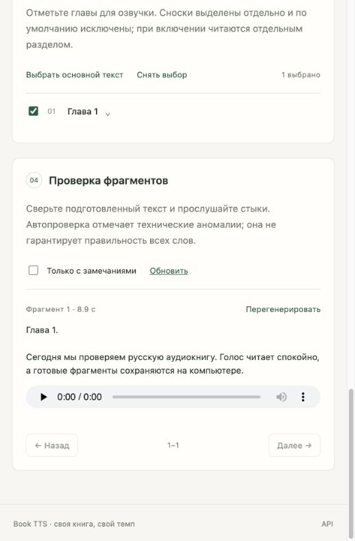

# Проверка MVP

12 ноября 2026. Среда: macOS, Apple Silicon, 64 ГБ памяти, FFmpeg 8.0. Веб-приложение — Python 3.13; отдельное окружение Qwen — Python 3.12.

## Автоматические проверки

- Ruff: проверка и форматирование Python-кода.
- Pytest: 30 тестов. Импорт TXT/EPUB/FB2, сноски и вложенные разделы, безопасный разбор XML, буквальные замены, полнота разбиения, ключи кэша, защита от устаревшего редактирования, пауза/продолжение/восстановление, отмена, ограниченные повторы, выборочная перегенерация, восстановление повреждённого кэша, HTTP API и контракт worker.
- FFmpeg действительно собирает M4B и MP3 в тесте; проверяются метаданные и порядок глав. Нейросинтез в этих тестах заменён коротким сигналом.

## Реальные пробы

- Kokoro ONNX, `af_heart`, CPU: сгенерирован английский текст; через браузер импортирован `examples/sample.en.txt`, собрана двухглавная аудиокнига M4B и ZIP с MP3. После ошибки сборки задание успешно продолжено с использованием сохранённого аудио.
- Короткий пример Kokoro: около 35 секунд речи; измеренный RTF около 0.38 с учётом первой загрузки движка. Это не прогноз для другой машины или длинной книги.
- Qwen3-TTS `0.6B-CustomVoice`, `Ryan`, CPU: реальная генерация русского отрывка, результат 10 секунд / 24 кГц. Первый запуск с загрузкой весов и инициализацией занял около 154 секунд; это время нельзя напрямую сравнивать с RTF прогретой модели.
- Через интерфейс выбран Qwen HTTP-worker: создана русская проба (8.9 секунды, RTF около 4.69 на CPU с инициализацией), затем из того же фрагмента собраны M4B с обложкой и MP3. Итоговый M4B успешно декодирован FFmpeg. Токен и локальные данные в репозиторий не включены.
- Проверены реальный русский синтез `say` / Milena, скачивание всех четырёх типов результатов с HTTP byte range и включение HTML/CSS/JS в установочный wheel.
- В `kokoro-onnx` 0.4.9 обнаружено несовпадение типа входа `speed` с опубликованным ONNX-экспортом. Адаптер приводит его к ожидаемому типу, сохраняя дробный темп для float-входа.

## Что ещё не подтверждено

- Нет субъективного выбора лучшего голоса пользователем и испытания на целой длинной книге.
- Качество ударений, акцент и отсутствие всех пропусков/повторов не гарантируются техническими тестами.
- Реальный инференс Chatterbox, Qwen Base с образцом, NVIDIA CUDA и удалённая GPU-машина пока не проверены.
- Финальный M4B ещё нужно проверить в целевом плеере пользователя.

## PDF: 13 ноября 2026

- Полностью обработана предоставленная пользователем английская книга: 306 отсканированных страниц, 30 последовательно пронумерованных глав, около 119 тысяч слов. Основной текст — PDF-страницы 9–304; вводные материалы (1–8) и заключительные (305–306) сохранены отдельными исключёнными разделами. Сам документ и результаты не опубликованы.
- Границы, в том числе внутри страницы и рядом с началом новой части, сверены с изображениями страниц 9, 28, 148, 247, 270 и 301. Глава 3 начинается на PDF-странице 28, глава 14 — на 148, глава 26 — на 270, глава 30 — на 301.
- Для всех сохранённых строк проверено непрерывное покрытие разделами без перекрытий и пропусков. Это проверка разбиения уже распознанного текста, а не гарантия безошибочного OCR.
- Проверены TXT, ZIP с 30 основными главами и двумя дополнительными разделами, JSON с текстом и страницами, HTTP-скачивание из локального приложения, повторное использование 306 сохранённых страниц без нового OCR.
- Добавлены тесты цифровых PDF без Tesseract, реального OCR синтетического скана, кэша страниц, заголовков посреди страницы, вводных материалов и частей, ложных номеров на обложке, пропущенных глав, колонтитулов (включая ошибки OCR в пагинации), абзацев и переносов, экспорта и загрузки через API. Всего проходит 42 теста.
- OCR остаётся требующим проверки: в скане возможны ошибки букв, пунктуации и имён. Локальная обработка — Tesseract 5.5.0, английская модель, растеризация до 4000 пикселей по длинной стороне, до четырёх одновременных страниц.
